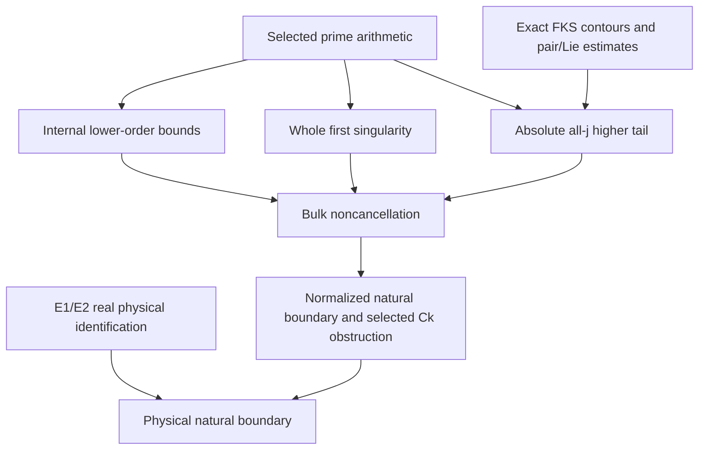

# Reading manuscript v0.1-rc6 and Lean v0.3.0-rc2

[Candidate PDF](../archive/manuscripts/pre-eight-2026-10-30/paper/next/manuscript.pdf) · [Current labels/pages](../archive/manuscripts/pre-eight-2026-10-30/paper/next/LABEL_INDEX.json) · [Version identities](VERSIONS.md). All 67 verified rc5 mathematical label numbers remain unchanged; Proposition F.1 is added.

| Stage | Manuscript | Actual interface |
|---|---|---|
| Physical identification | §2, Appendix F | E1/E2, real low-temperature data and local inverse-temperature sheets. |
| Dense first-order family | Theorem 3.1 | First even Nickel order and exact non-Nickel facts below it. |
| Whole first singularity | Theorem 4.4, Lemma 4.3 | Actual residues, nonzero coefficient, bounded lower derivatives and compatible remainder. |
| Internal lower orders | Unnumbered argument before Theorem 4.4 | NonNickelGeometry → generic complement IBP → NonNickelRadialBounds → lower-order endpoints. No E3. |
| Selected contour | Proposition 6.1 | Actual protected `c/N` disk and `1+C/N` pair bound, already present in baseline Lean. |
| Entire higher tail | Theorem 9.1, §§5–8, Appendices C–E/G | Existing complete contour and all-j absolute-tail assembly. |
| Final composition | Theorem 9.2, Corollary 9.3 | Canonical NB endpoints with lower-order and tail estimates discharged internally. |
| Regularity | Corollary 9.4 | Genuine selected-point real Ck obstruction formalized; quantitative prime covering manuscript-only. |
| Complete amplitude | Appendix B (B.1), Proposition F.1 | Full-site observable fixed by the cited integral; four-chart conversion and radial Taylor reconstruction manuscript-only; existing formal nonvanishing retained. |

For E3, read the coordinate balances and `ActiveCombination.nickel_of_productX_pos` / `zero_of_nonNickel`. The single-product case matters: the other coordinates are +1, hence it too yields a Nickel equation. The analytic core retains actual smooth weights, denominators, half-line exponentials, generated IBP coefficient derivatives, derivative interchange, finite torus refinement and radius locality. The radius is selected at the evaluation point and held fixed while differentiating. The stronger published neighborhood-uniform proposition is not claimed as an internally proved substitute.

For Proposition 6.1, hold the branch root at its complex-disk value and move only the compact radial-center root. Its denominator stays uniformly separated from the closed lower disk. Existing actual root-image theorems cover transition supports and strict same-group contraction. The weaker downstream square-root inflation remains a valid budget.

For the amplitude, start with the review's (45) and its cited angular integral; this fixes C_N^std. Read the root continuation in Im S>0 before evaluating any complex power. Proposition F.1 converts the kth derivative asymptotic to a radial power modulo a finite Taylor polynomial and counts four signed angular centers. The lower double-contour T_N has two charts, whereas the full offsite coefficient is 2T_N. The complete coefficient is 4R_N(-theta_*)=-4iR_N(theta_*). The formula is arXiv (69), journal (70); the review's printed (64) has a sign inconsistent with its following roots. The derivation and physical-prefactor branches, not that sign or the cosine relation alone, fix the result.

For regularity, an agreeing real smooth extension on a neighborhood is stronger than a boundary trace. The formal proof restricts complex Fréchet derivatives to real scalars; it does not assume a smooth extension is holomorphic. The finite prime precedes point-dependent constants and limits.

Historical W1/W2 repairs and CR0/MR1 failures retain their [original scope](VERSIONS.md). [Coverage](../lean/COVERAGE.md), [mathematical changes](AMPLITUDE_IDENTIFICATION_v0.3.0-rc2.md), and [validation](../release/next/VALIDATION.json) govern this candidate.
